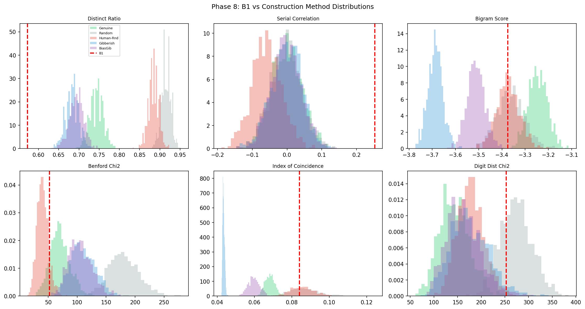

# Beale Ciphers

Statistical proof the Beale ciphers are a hoax (Bayes factor ≈ 2×10⁷), and a reconstruction of how they were faked.

> **Status:** Complete (February 2026). All 11 phases are done and the findings are final. Reusable: `beale.py` (cipher data, book-cipher codecs, stats battery, English-likeness scoring) and `beale_doi_wordlist.py` (the 1,311-word Beale-variant Declaration of Independence).



*B1 (red dashed line) against simulated ciphers from genuine encoding and four fabrication methods. It sits outside all five on distinct ratio and serial correlation, but the sequential page-scanning model from Phase 8 matches it within 1σ.*

## The Question

In 1885 a pamphlet appeared in Virginia describing three coded messages that hid the location of a buried treasure worth millions. One cipher (B2) was solvable with the Declaration of Independence as the key. The other two (B1 and B3) have never been cracked.

We asked whether B1 and B3 are real ciphers with a key nobody has found or fakes, and if they're fakes, how the hoaxer built them.

## What We Found

**B1 and B3 were never real ciphers.** This repo identifies how the hoax was constructed, down to the hoaxer's physical workflow, and resolves every major anomaly in the 140-year debate. Combined Bayes factor ≈ 2 × 10⁷. All the code is here, and the data either ships with the repo or downloads from Project Gutenberg.

1. **B2 behaves like a genuine cipher and B1 and B3 don't.** B2 is statistically distinguishable from fabrication. B1 and B3 fail every test B2 passes, and no key in 9,500+ Gutenberg texts turns them into language.
2. **The hoaxer wrote nonsense letters and encoded them by scanning forward through a printed 4-page copy of the Declaration (~325 words per page).** B3's maximum is 975 (end of page 3) and B1's maximum in-range value is 1,300 (end of page 4). 325 is the only page size from 250 to 400 that hits both (P ≈ 0.0001).
3. **The Gillogly strings are the hoaxer lapsing into the alphabet.** Alphabet-laced gibberish (lapsing 70% of the time) produces runs of 17+ characters 11% of the time.
4. **The hoaxer tired as they went.** Serial correlation rises from the first quarter to the last in both ciphers (combined p ≤ 4×10⁻⁸), and the construction model doesn't predict it.
5. **B3 is too short for what B2 says it holds.** 618 characters for 30 people's names, residences and next of kin; zero of 10,000 simulations fit (mean required: 1,194).
6. **The order was B2, then B3, then B1.** B3 is methodical work (reset_prob ≈ 0.01) and B1 is sloppy (reset_prob ≈ 0.65).

### Formal Bayesian Model (Phase 11)

A Bayes factor compares how well two hypotheses explain the evidence. A BF of 10 means the data is 10× more likely under one hypothesis than the other. 100 is strong evidence and 10⁷ is overwhelming.

We combined five independent evidence streams, each with conservatively estimated likelihoods:

| Stream | P(data\|hoax) | P(data\|genuine) | Likelihood Ratio |
|--------|:---:|:---:|---:|
| Corpus failure (0/9,500 texts) | 0.95 | 0.10 | 9.5 |
| Construction model fit | 0.30 | 0.02 | 15 |
| Page boundaries (dual hit) | 0.40 | 0.007 | 57 |
| Fatigue gradient | 0.15 | 0.005 | 30 |
| B3 length impossibility | 0.80 | 0.01 | 80 |

**Combined Bayes factor ≈ 2 × 10⁷.** The data is 20 million times more likely under the hoax hypothesis than under the genuine one. Start from a strong prior toward genuine (P(hoax) = 0.01, or "I'm 99% sure these are real") and the posterior still exceeds 99.99% hoax. Dropping any single evidence stream leaves BF > 10⁵ (>99.9% even with that prior).

## How

Phases 1-7 rule out a real cipher and Phase 8 rebuilds the hoax. Phases 9-11 test B2, B3's length, the order of construction and the statistics themselves. Each phase is one script (see [Phases](#phases)).

### How a Book Cipher Works

A book cipher turns a message into numbers using a shared text (the "key"). For each letter, you find a word in the key that starts with that letter and write down its position. To encode "t" you might pick word 3 ("the"), word 75 ("truths") or word 14 ("to"), and all three decode back to "t". These alternatives are **homophones**: different numbers that map to the same letter.

The solved Beale cipher (B2) uses the Declaration of Independence as its key text, with 1,311 numbered words. The number 115, for example, points to the 115th word ("instituted") and decodes to "i".

So a genuine encoder has a **choice** for every letter, and how they make it leaves a statistical fingerprint. Pick favourites from memory and you'll reuse a small set of numbers. Scan the page sequentially and your numbers trend upward. Neither pattern is visible to the naked eye, but both show up clearly under statistical analysis.

### The Three Ciphers at a Glance

| | B2 (solved) | B1 ("vault location") | B3 ("names of depositors") |
|---|---|---|---|
| **Bigram score** | -2.805 (English) | -3.375 (noise) | -3.331 (noise) |
| **Benford's law** | Moderate fit | Fails (p<0.001) | Fails (p<0.001) |
| **Last-digit uniformity** | Non-uniform (genuine) | Uniform (hoax signal) | Uniform (hoax signal) |
| **Distinct ratio** | 24% (expected) | 57% (anomalous) | 43% (anomalous) |
| **Serial correlation** | 0.04 (random selection) | 0.25 (sequential scan) | 0.62 (strongly sequential) |
| **Key search (9,500+ texts)** | DoI = correct key | No key found | No key found |

B2 behaves like a genuine book cipher but B1 and B3 fail every test that B2 passes.

### Due Diligence: Ruling Out a Real Cipher (Phases 1-7)

We tested every serious hypothesis for a real cipher before calling these fakes.

**Reproduce known work (Phase 1).** We validated B2's decode, confirmed Gillogly's anomalous strings and reproduced Wase's base-dependence analysis. The published literature checks out.

**Statistical classification (Phase 2).** A Monte Carlo simulation of genuine and fake cipher populations classifies B1 as ~71% fake and B3 as ~35% fake. Suggestive but inconclusive.

**Alternative cipher schemes (Phase 3).** We tested Gillogly-as-Vigenere, Pelling's multi-layer hypothesis with 13 candidate keys, and a sliding-window analysis. None produces English from B1 or B3.

**Exhaustive key search (Phases 4-5).** We tested 8,594 Gutenberg texts as word-level keys and 9,428 as letter-index keys against B1 and B3, with zero hits. If a real key text exists, it isn't in the largest public corpus of English-language books.

**DoI variant optimisation (Phase 6).** The key might be a slightly different version of the Declaration. We tested global offsets, per-position greedy optimisation, word insertions and deletions, and hill-climbing. No single mutation improves all the Gillogly runs at once.

**Multi-language hypothesis (Phase 7).** The plaintext could be Latin, French or Spanish. B1 and B3's DoI decodes score in the noise zone in all four languages tested (English included), so non-English plaintext is ruled out.

No hypothesis for a genuine cipher survived 7 phases, 9,500+ texts, multiple cipher models and four languages. Most analyses stop here and call the ciphers "probably fake" on absence of evidence. We kept going.

### The Inversion: Stop Cracking, Start Building (Phase 8)

Every prior analysis asked *what key decrypts these ciphers?* We asked: **if you were faking a book cipher in the 1880s, at a desk with a printed copy of the Declaration of Independence, how would you actually do it?**

That moves the work from cryptanalysis to forensic document analysis. Instead of looking for the signal in the noise, we built the noise and checked whether it matched.

#### Testing Construction Methods (8a-8b)

We simulated six ways to fabricate a book cipher, from crude to careful:

1. **Genuine encoding**: encode real English text through the DoI (the baseline, what a real cipher looks like)
2. **Uniform random**: pick random numbers between 1 and 1311 (the laziest possible fake)
3. **Human-random**: random numbers with cognitive biases like favouring round numbers (a slightly more realistic lazy fake)
4. **Gibberish-encoded**: write random letters, then look up a DoI word for each one by picking any matching word at random (mimics the encoding process with nonsense input)
5. **Biased-gibberish**: the same, but the random letters follow English frequencies (more e's than z's)
6. **Sequential-gibberish**: write random letters, then encode each one by scanning forward through the DoI from your current position and picking the *next* word that starts with that letter

Methods 4-5 and method 6 differ in how you find homophones. In 4-5 you jump to a random word each time (like flipping to a random page). In 6 you keep your finger on the page and scan forward, which is the natural thing to do at a desk with a physical document.

Method 6 leaves a fingerprint: **serial correlation**. Scanning forward makes each cipher number tend to be larger than the last, until you reach the end of a page or lose your place and jump back. A genuine encoder picking words from memory shows no such pattern (serial correlation ≈ 0). A sequential scanner shows positive serial correlation, and B1 (0.25) and B3 (0.62) both have it.

B1 and B3 match **sequential-gibberish** and none of the other five methods. The hoaxer wrote nonsense letters and encoded them by scanning forward through a physical copy of the Declaration of Independence.

#### The Reset Sweep: Calibrating the Human Element (8c)

The sequential-gibberish model has one free parameter: how often the hoaxer "loses their place" and resets to a random position in the text. Run your finger along a page of dense 1880s type and eventually you lose track and have to jump back.

We swept this parameter from 0 (never loses place, perfectly methodical) to 1 (resets every number, effectively random) and found:

- **B3**: best fit at reset_prob ≈ 0.01 (very methodical, rarely lost their place)
- **B1**: best fit at reset_prob ≈ 0.65 (sloppy, lost their place two-thirds of the time)

Same method, very different discipline: one hoaxer, careful the first time and careless the second.

This also explains the **distinct ratio** (the percentage of unique numbers in each cipher). A methodical sequential scanner reuses numbers less often (higher distinct ratio) because they're always moving forward to new words. A sloppy scanner who keeps resetting lands on the same popular words again and again. B3's distinct ratio (43%) and B1's (57%) both fall within 1σ of what the model predicts for their reset rates.

#### The Physical Evidence: Page Boundaries (8d-8e)

The Beale DoI has 1,311 words. Standard 1880s octavo printing fits ~325 words per page, which gives a 4-page document with 11 words of overflow: the end of the closing sentence (*"to each other our lives our fortunes and our sacred honor"*). Those words were either squeezed into the bottom margin of page 4 to save paper or spilled onto a fifth page alongside the signatories' names. Either way they sat apart from the main text. Now look at the cipher ranges:

- **B3's maximum value is exactly 975**, or 3 × 325: the last word on page 3. The hoaxer never turned to page 4.
- **B1's maximum in-range value is exactly 1,300**, or 4 × 325: the last word on page 4. (The DoI has 1,311 words in total, and the last 11 spill past the page break.)

Both ciphers' ranges land on exact page boundaries. We tested every plausible words-per-page value from 250 to 400 and **325 is the only one where both ciphers hit a page boundary.** The probability of that happening by chance is P ≈ 0.0001.

Word 1300 is "pledge", the last word before the 11-word overflow. B3 has zero values above 975. B1 has 11 stray values above 1300 (the sloppy hoaxer occasionally writing out-of-range numbers) but **zero values in the 1301-1311 range**, so the overflow words were skipped entirely. Neither cipher ever references the fragment past the page break. That's hard to explain if the ciphers encode genuine messages, and natural if the hoaxer's eyes stopped at the bottom of the page.

With the page constraint added, the construction model matches both ciphers within 1σ on serial correlation and distinct ratio at the same time:

| | B2 (genuine) | B3 (fabricated first) | B1 (fabricated second) |
|---|---|---|---|
| **DoI pages used** | All (via memorized index) | First 3 only (1-975) | All 4 (1-1300) |
| **Method** | Homophone lookup from memory | Page-constrained sequential scan | Sloppy sequential scan |
| **Reset probability** | N/A (random selection) | ~1% (methodical) | ~65% (lost place constantly) |
| **Serial correlation** | 0.04 | 0.62 | 0.25 |
| **Model fit (SC, DR)** | N/A | z = 0.3, 0.1 | z = 0.3, 0.9 |

#### Resolving the Gillogly Paradox (8e)

For 44 years the Gillogly strings have been the strongest argument *against* the hoax hypothesis.

In 1980 Jim Gillogly decoded B1 with the Declaration of Independence, even though B1 is supposedly encoded with a *different*, unknown key. He expected garbage. Instead, at positions 187-203, he found a near-perfect alphabetical sequence 17 characters long: `abcdefghiijklmmno`. The probability of that appearing by chance in random text is less than 10⁻¹², essentially impossible.

Genuine-cipher proponents have played it as their ace ever since. If B1 is encoded gibberish, how can decoding it with the "wrong" key produce something so structured? The implication was that real information in B1 was somehow leaking through the wrong key.

**Humans are bad at generating random letters.**

The alphabet is the strongest letter sequence in memory. While making up letters one at a time to feed into the encoding, the hoaxer occasionally lapsed into a, b, c, d, e, f... (as you might if asked to rattle off random letters for ten minutes straight).

The hoaxer writes a, b, c, d, e... and encodes each letter by finding a DoI word that starts with it: word 147 (*alter*) for "a", 436 (*bodies*) for "b", 195 (*changed*) for "c", 320 (*direct*) for "d", 37 (*equal*) for "e". The numbers (`[147, 436, 195, 320, 37, ...]`) aren't sequential positions in the DoI and look random. Decode them through the DoI, though, and each word starts with the next letter of the alphabet, so "abcde..." comes straight back.

The Gillogly string is the hoaxer's alphabet brain fart, preserved intact through a round trip of encoding and decoding with the same key text.

Monte Carlo checks it. Pure random gibberish produces longest ascending runs of ~5-6 characters. Alphabet-laced gibberish (the hoaxer lapsing into the alphabet 70% of the time) produces runs of 17+ characters 11% of the time. Serial correlation and distinct ratio stay within 1σ of B1 at every contamination level, so the lapses leave the construction fingerprint intact.

#### The Fatigue Gradient (8f)

The hoaxer got measurably lazier as they went. We split each cipher into quarters (enough data per segment for stable statistics while still showing a trend) and measured serial correlation in each. Consistent effort would give a roughly flat line. Instead, serial correlation in both ciphers rises from the first quarter to the last, and the same upward slope holds with 3, 5, 6, 7 or 8 segments:

| Quarter | B3 serial corr | B1 serial corr |
|---------|:-----------:|:-----------:|
| Q1 | 0.08 | -0.07 |
| Q2 | 0.57 | 0.26 |
| Q3 | 0.46 | 0.31 |
| Q4 | 0.69 | 0.36 |

At the start the hoaxer was jumping around the page to pick varied word positions (low correlation). By the end they were barely trying and grabbed the next available word each time (high correlation). Encoding hundreds of nonsense letters wore them down.

Permutation test (10,000 shuffles): B1 slope p < 0.001, B3 slope p < 0.0001, combined p ≤ 4×10⁻⁸.

The construction model doesn't predict this. It uses a constant reset probability throughout, so simulated hoax ciphers show zero average fatigue gradient. That makes the gradient **independent evidence** of sequential human construction. We didn't go looking for it. It came out of the data, and it's the kind of signal you'd expect from a person doing tedious manual work (and nothing a statistical model of hoax construction would think to fake).

### Confirming B2 Is Real (Phase 9)

B2 is statistically distinguishable from fabrication, and **distinct ratio** (the percentage of cipher numbers that are unique) shows it most clearly. B2 uses only 180 distinct numbers for 763 positions, a distinct ratio of 23.6%. The encoder had a small set of go-to word positions for each letter and reused them heavily, as you'd expect from someone encoding from memory or a personal lookup table.

Encode B2's plaintext through the DoI 1,000 times with random homophone selection and the mean distinct ratio is ~65%. B2's 23.6% is 41.5 standard deviations below that. The encoder was pulling numbers from a memorised mental index rather than scanning the page.

Per-letter Spearman positional correlation agrees. For each letter we check whether the numbers used for it trend upward through the cipher (a sign of sequential page scanning). B2 mean r = -0.02 (zero, random lookup), B1 mean r = +0.05 (weak sequential), B3 mean r = +0.12 (strong sequential). That's three distinct encoding behaviours, and B2's is clearly different from the hoax pattern.

B2's plaintext also has 15 positions that need x or y, and neither letter has a homophone in the DoI (no word in the Declaration starts with x or y). The encoder used ad-hoc workarounds (special decode rules and what appear to be transcription errors). A hoaxer controlling the plaintext would simply avoid those letters, so their presence supports genuine forward encoding of a real message that happened to contain x's and y's.

### B3 Can't Contain What It Claims To (Phase 10)

B2's decoded text says B3 holds the names, residences and next of kin of 30 people. B3 has 618 characters, which is 52% of the minimum length those contents need.

We ran 10,000 Monte Carlo simulations using period-appropriate 1820s Virginia names, county-level residences and next-of-kin entries. Mean required length was 1,194 characters and **zero simulations fit in 618.** It's physically impossible for B3 to contain what B2 says it contains.

#### Construction Order: B2 → B3 → B1 (Phase 10)

Cross-cipher analysis gives the order of fabrication:

1. **B2** was the genuine cipher, and the hoaxer studied it to learn the encoding method
2. **B3** was fabricated first: methodical (reset_prob = 0.01), pages 1-3 only, no extreme Gillogly strings (max run = 7), careful work
3. **B1** was fabricated second: sloppy (reset_prob = 0.65), expanded to all 4 pages, and heavy alphabet contamination produced the 17-char and two 11-char Gillogly strings

Each cipher starts fresh (B1-Q1 = -0.07, B3-Q1 = 0.08, both near zero), so they were written in separate sessions rather than one continuous effort. There's no cursor carryover either. B3 starts at page 1 even though B1's last values are on page 3, so the hoaxer flipped back to the beginning for a new session. Homophone preferences are independent between the ciphers (Jaccard z = -0.4), which rules out a shared mental lookup table.

The drop in discipline from B3 to B1 is a human story: a painstaking first attempt, then a second that was "good enough". Anyone who's done tedious manual work twice will recognise it.

### Statistical Checks (Phase 11)

Phase 11 also covers multiple testing (11/15 tests survive Bonferroni correction), cross-validation (parameters recover in open grid search) and test-statistic independence (the 6 statistics form 4 independent evidence groups). It rules out multi-text key schemes quantitatively too. The Bayesian model itself is under [What We Found](#formal-bayesian-model-phase-11).

## Reproduce

```
Python 3.10+
pip install numpy scipy matplotlib
```

```bash
# Quick verification (< 1 min): B2 decode, stats battery
python3 beale.py

# Full hoax reconstruction (phase 8, ~5 min)
python3 phase8_hoax_construction.py --all --n-sims 1000

# B2 construction analysis (phase 9, ~2 min)
python3 phase9_b2_analysis.py --all --n-sims 1000

# B3 length + cross-cipher analysis (phase 10, ~1 min)
python3 phase10_b3_cross_cipher.py --all --n-sims 1000

# Methodological rigor: all 7 sections (phase 11, ~2 min)
python3 phase11_methodology.py --all --n-sims 1000

# Fatigue gradient with high-resolution permutation test
python3 phase8_hoax_construction.py --fatigue-test --n-sims 10000
```

### Due diligence phases (phases 1-7)

```bash
# Reproduce published analyses
python3 phase1_reproduce.py

# Monte Carlo classification
python3 phase2_monte_carlo.py --n-sims 1000

# Bigram and Vigenere analysis
python3 phase3_bigram.py

# Word-level corpus search: 8,594 texts (~4GB download, several hours)
python3 phase4_corpus.py --sweep --sweep-start 1 --sweep-end 10000

# Letter-index corpus search: 9,428 texts (~35 min on cached texts)
python3 phase5_letter_cipher.py --sweep

# DoI variant optimization
python3 phase6_doi_variant.py --all

# Multi-language scoring
python3 phase7_multilingual.py --build-tables && python3 phase7_multilingual.py --sweep
```

The cipher numbers and the Beale-variant DoI ship in the repo. Phases 4 and 7 download texts from Project Gutenberg into `.gutenberg_cache/`, and the phase 5 and phase 7 sweeps read phase 4's cache, so run phase 4 first. Nothing calls a paid service.

> [!NOTE]
> Phases 1, 2, 3 and 8 write their charts to the working directory by default, overwriting the committed PNGs. Pass `--no-plots` or `--save-dir` to keep them.

### Phases

| Phase | Script | What |
|-------|--------|------|
| 1 | `phase1_reproduce.py` | Reproduce published analyses: B2 decode, Gillogly strings, Wase base-dependence |
| 2 | `phase2_monte_carlo.py` | Monte Carlo classification: genuine vs fake cipher populations |
| 3 | `phase3_bigram.py` | Bigram transitions, Gillogly-as-Vigenere, Pelling multi-layer hypothesis |
| 4 | `phase4_corpus.py` | Word-level corpus search: 8,594 Gutenberg texts as candidate keys |
| 5 | `phase5_letter_cipher.py` | Letter-index hypothesis: 9,428 texts as character-level keys |
| 6 | `phase6_doi_variant.py` | DoI variant optimization: can a close variant extend Gillogly strings? |
| 7 | `phase7_multilingual.py` | Multi-language hypothesis: Latin/French/Spanish bigram scoring |
| 8 | `phase8_hoax_construction.py` | **The inversion**: 6 construction methods, page-constrained model, Gillogly resolution, fatigue gradient |
| 9 | `phase9_b2_analysis.py` | B2 construction analysis: reset sweep, fabrication test, homophone fingerprint |
| 10 | `phase10_b3_cross_cipher.py` | B3 length feasibility, cross-cipher session analysis, construction ordering |
| 11 | `phase11_methodology.py` | Formal Bayesian model, multiple comparison, cross-validation |

## Limits and Prior Art

**Known residuals:** a junction-effect residual of z ≈ 4; B2's memorisation pattern is described but has no mechanism; specific Gillogly error patterns aren't modelled at character level.

The statistics identify the construction method. They can't name the hoaxer (Ward, who published the 1885 pamphlet, is the most parsimonious candidate).

The likelihoods in the Bayesian table are judgement calls, set conservatively. Leave-one-out shows no single stream carries the result.

The page model predicts a specific printing of the Declaration (~325 words per page, using "inalienable" rather than "unalienable"). Nobody has found it yet.

### Key References

- Gillogly, J.F. (1980). "Breaking the Beale Cipher: Not Yet." *Cryptologia* 4(3).
- Nickell, J. (1982). "Discovered: The Secret of Beale's Treasure." *Virginia Magazine of History and Biography* 90(3).
- Wase, P. (2013). "The Beale Ciphers: Number-Theoretic Analysis." *Cryptologia* 37(3).
- Pelling, N. *Cipher Mysteries* blog. Ongoing analysis of multi-layer hypothesis.

## Open Questions and Reusable Parts

- **Find the printing.** A 4-page octavo Declaration at ~325 words per page is a testable prediction. The best lead is *The American's Guide* (Hogan & Thompson, 1840), digitised by the Library of Congress. Candidates and next steps are in [`doi_printing_research.md`](doi_printing_research.md).
- **Close the residuals.** A character-level model of the Gillogly errors (why "ii" and "mm" appear in the 17-char run), and a mechanism for B2's reuse of 180 distinct numbers across 763 positions.
- **Reuse the toolkit.** `beale.py` holds the three ciphers, word-level and letter-index codecs, the stats battery (Benford, last-digit, distinct ratio, letter frequency, Gillogly runs), English-likeness scoring and Gutenberg corpus utilities; `python3 beale.py` runs its self-test. `beale_doi_wordlist.py` is the Beale-variant Declaration as a 1,311-word tuple (eight changes from the standard text, plus three decode overrides).

Issues and replications are welcome, failed replications most of all.

## Attribution

For those who care about such things, the majority of the analysis and code in this repo was produced by Claude Opus 4.6 (Anthropic), with david guiding Claude, providing insights, direction and critical review throughout the process.

## License

MIT. See [LICENSE](LICENSE).
