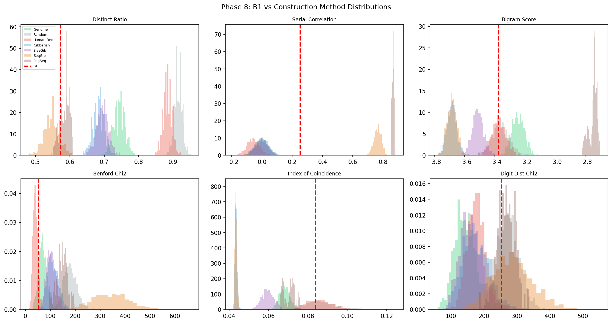

# Beale Ciphers

Nobody has cracked Beale ciphers B1 and B3 in 140 years. After the key search came up empty (9,500+ texts, four languages, nothing) we stopped hunting and modelled how you'd fake a book cipher at an 1880s desk instead. Both ciphers match the fake within 1σ. Bayes factor ≈ 2×10⁷ for hoax over genuine, and a reconstruction of how the hoaxer worked.

> **Status:** Complete (February 2026). All 12 phases are done and the findings are final. Reusable: `beale.py` (cipher data, book-cipher codecs, stats battery, English-likeness scoring) and `beale_doi_wordlist.py` (the 1,311-word Beale-variant Declaration of Independence).



*B1 (red dashed line) against simulated ciphers from genuine encoding and four fabrication methods. It sits outside all five on distinct ratio and serial correlation. The page-scanning model from phase 8 matches it within 1σ.*

## The approach

In 1885 a Virginia pamphlet published three number ciphers said to hide a treasure worth millions. B2 decodes with the Declaration of Independence as the key and describes the treasure. B1 (the vault's location) and B3 (the owners' names) have never decoded against anything.

Every analysis since has asked what key decrypts B1 and B3. We ran that search as due diligence and it came back empty, which gets you to "probably fake" on absence of evidence. That's where most analyses stop.

The real work assumed the ciphers were faked and asked a different question. Someone at a desk in the 1880s with a printed Declaration in front of them, making up a cipher that has to pass as real: what do their numbers look like? Model that person, generate the noise they'd produce, check whether B1 and B3 match it.

They do, within 1σ on both statistics that separate real book ciphers from fakes. The model also predicted three things we never built into it: both ciphers stop at a page boundary of a 4-page printing, the Gillogly alphabet strings fall out of the method for free, and both ciphers get sloppier from start to finish.

## How do you fake a book cipher?

**A book cipher is a lookup against a shared text.** For each letter you find a word in the key text starting with that letter and write down its position. The Beale key is the Declaration of Independence, 1,311 numbered words. To encode "t" you could use word 3 (*the*), 14 (*to*) or 75 (*truths*) and all three decode back to "t". Every letter has a choice like that, and how the encoder makes it leaves a fingerprint. Pick favourites from memory and you reuse a small set of numbers. Run your finger down the page and your numbers climb.

**We simulated six ways to produce one.**

1. Genuine encoding of real English through the Declaration (the baseline)
2. Uniform random numbers from 1 to 1311 (the laziest fake)
3. Human-random numbers, with round-number bias and the other habits people have
4. Gibberish letters, each encoded by jumping to a random matching word
5. The same, with the gibberish following English letter frequencies
6. Sequential gibberish: make up a letter, scan forward from where your finger is to the next word starting with it, write down its number, repeat

**Only sequential scanning produces serial correlation.** Scanning forward makes each number tend to be bigger than the last, until you reach the end of a page or lose your place and jump back. A genuine encoder working from memory shows none of it, and B2 sits at 0.04. B1 is at 0.25 and B3 at 0.62. The other five methods can't get there.

**The one free parameter is how often the hoaxer loses their place.** Run a finger along dense 1880s type for long enough and you lose track and jump back. We swept that reset probability from 0 (never) to 1 (every number). B3 fits at about 0.01 and B1 at about 0.65. Same method, very different discipline.

**The page limit does the rest.** Reset rate barely moves distinct ratio (55% to 59% across the whole sweep for a B1-length cipher). What drives it is how much of the text the hoaxer was working from, since fewer words means fewer homophones per letter. Hold the model to the first 975 words for B3 and the first 1,300 for B1 and it lands within 1σ on serial correlation and distinct ratio at the same time:

| | B2 (genuine) | B3 (faked first) | B1 (faked second) |
|---|---|---|---|
| **Words used** | all, from memory | 1-975 (pages 1-3) | 1-1300 (pages 1-4) |
| **Reset probability** | n/a | ~0.01 | ~0.65 |
| **Serial correlation** | 0.04 | 0.62 | 0.25 |
| **Distinct ratio** | 24% | 43% | 57% |
| **Model fit (SC, DR)** | n/a | z = 0.3, 0.1 | z = 0.3, 0.9 |

## What did the model predict that we didn't put in?

Three things. None is a parameter of the model. Each is what you'd expect from a person doing the job by hand and nothing a hoaxer would think to fake.

### Page boundaries

**Both ciphers stop at the bottom of a page.** An 1880s octavo fits about 325 words of the Declaration per page, so 1,311 words run to 4 pages plus 11 words of overflow (*to each other our lives our fortunes and our sacred honor*), squeezed into the bottom margin or spilled onto the signatures page. B3's highest number is 975, which is 3 × 325, the last word on page 3. B1's highest in-range number is 1,300, which is 4 × 325, the last word on page 4. We tested every page size from 250 to 400 words and 325 is the only one that puts both ciphers on a boundary (P ≈ 0.0001).

**Neither cipher ever touches the overflow.** B1 has 11 stray numbers past the end of the text (the sloppy session writing out-of-range values) and zero in 1,301-1,311. B3 has nothing above 975. A real message encoded against the whole text would land on those words now and then. The hoaxer's eyes stopped at the bottom of the page.

### The Gillogly strings

**The strongest argument for a real cipher falls out of the method.** In 1980 Jim Gillogly decoded B1 with the Declaration, the wrong key by the story's own account, and found `abcdefghiijklmmno` at positions 187-203. Seventeen near-alphabetical characters in a row, odds under 10⁻¹² by chance. Genuine-cipher proponents have played it as their ace since. If B1 is encoded gibberish, how does structure leak through the wrong key?

**Humans are bad at making up random letters.** The alphabet is the strongest letter sequence in memory, and a hoaxer generating hundreds of letters by hand lapses into a, b, c, d... now and then. Encode that through the Declaration (word 147 *alter* for a, 436 *bodies* for b, 195 *changed* for c) and the numbers look random. Decode them with the same text and the alphabet comes straight back. The Gillogly string is the hoaxer's alphabet brain fart, preserved through a round trip of encoding and decoding with the same key.

**Monte Carlo agrees.** Pure random gibberish gives longest runs of 5-6. Gibberish with alphabet lapses 70% of the time gives runs of 17+ about 11% of the time, and serial correlation and distinct ratio stay within 1σ of B1 at every lapse rate.

### Fatigue

**The hoaxer got lazier as each session went on.** Split each cipher into quarters and measure serial correlation in each. Consistent effort gives a flat line. Both ciphers rise from the first quarter to the last:

| Quarter | B3 | B1 |
|---|:---:|:---:|
| Q1 | 0.08 | -0.07 |
| Q2 | 0.57 | 0.26 |
| Q3 | 0.46 | 0.31 |
| Q4 | 0.69 | 0.36 |

Early on they jumped around the page for variety. By the end they grabbed the next available word every time. Permutation test over 10,000 shuffles: B1 p < 0.001, B3 p < 0.0001, combined p ≤ 4×10⁻⁸, and the slope holds with 3 to 8 segments.

**The model doesn't predict this.** It runs a constant reset probability, so simulated hoaxes have no fatigue gradient on average. That makes it independent evidence. We didn't go looking for it, it came out of the data.

## Checks on the story

**B2 is real.** B2 uses 180 distinct numbers across 763 positions, a distinct ratio of 23.6%. Encode its plaintext 1,000 times with random homophone choice and the mean is 64%, so B2 sits 43σ below it. The encoder worked from a memorised index or a personal lookup table, and at a serial correlation of 0.04 they weren't scanning the page. B2's plaintext also needs x and y 13 times, and the Declaration has no word starting with either. Every x is number 1005 (*have*) and every y is 811 (*fundamentally*), 13 of 13. A hoaxer writing the plaintext would have avoided those letters. Per-letter positional correlation can't separate B2 from B1 or B3 (Mann-Whitney p = 0.78 and 0.20), so the split rests on distinct ratio and serial correlation.

**B3 can't hold what B2 says it holds.** B2 says B3 lists the names, residences and next of kin of 30 people. B3 is 618 characters. Simulating that content 10,000 times with 1820s Virginia names and county-level residences gives a mean of 1,194 characters and zero fits under 618.

**The order was B2, then B3, then B1.** B2 names B3's contents, so B3 had to exist first. B3 is the careful job: reset probability 0.01, pages 1-3 only, longest Gillogly run 7. B1 is the second attempt: reset probability 0.65, all 4 pages, the 17-character run and two of 11. Each starts near zero serial correlation (B3 0.08, B1 -0.07 in the first quarter), so separate sessions, and homophone preferences are independent between them (Jaccard z = -0.4), so no shared lookup table. Anyone who has done tedious manual work twice will recognise the drop from B3 to B1.

**Due diligence came first.** Before any of this we tested every serious case for a real cipher:

| Hypothesis | Test | Result |
|---|---|---|
| Published analyses hold up (phase 1) | B2 decode, Gillogly strings, Wase's base-dependence | Decode and Gillogly check out. Wase's last-digit signal holds for B3 and not B1 |
| Statistics alone can classify (phase 2) | Monte Carlo against genuine and fake populations | B1 ~71% fake, B3 ~35%. Suggestive only |
| Another cipher scheme (phase 3) | Gillogly-as-Vigenère, Pelling's multi-layer with 13 keys, sliding window | No English |
| An unknown key text (phases 4-5) | 8,594 Gutenberg texts as word keys, 9,428 as letter-index keys | Zero hits |
| A variant Declaration (phase 6) | Offsets, insertions, deletions, hill-climbing | No single edit improves all the Gillogly runs |
| Non-English plaintext (phase 7) | Latin, French, Spanish bigram scoring | Noise in all four languages |
| A second cipher layer (phase 12) | Columnar transposition, all 157,248 Hill 2×2 matrices, autokey, Vigenère, Beaufort, index of coincidence to period 25 | Nothing beats shuffled letters (p ≥ 0.17). The same searches recover a key planted on B2 every time |

## How sure?

**Five independent evidence streams, likelihoods set conservatively.** A Bayes factor is how much more likely the data is under one hypothesis than the other. 10 is mild, 100 is strong, 10⁷ is overwhelming.

| Stream | P(data\|hoax) | P(data\|genuine) | Ratio |
|---|:---:|:---:|---:|
| No key in 9,500+ texts | 0.95 | 0.10 | 9.5 |
| Construction model fit | 0.30 | 0.02 | 15 |
| Page boundaries, both ciphers | 0.40 | 0.007 | 57 |
| Fatigue gradient | 0.15 | 0.005 | 30 |
| B3 length | 0.80 | 0.01 | 80 |

**Combined Bayes factor ≈ 2×10⁷.** Start 99% sure the ciphers are real and you end above 99.99% hoax. Drop any one stream and the factor stays above 10⁵. Phase 11 also runs the multiple-comparison correction (11 of 15 tests survive Bonferroni), recovers the model parameters in an open grid search, and checks that the six statistics form four independent groups.

## Limits

**The statistics identify a method, not a person.** Ward, who published the 1885 pamphlet, is the most parsimonious candidate, and that's as far as the data goes.

**The likelihoods are judgement calls.** Set low for hoax and high for genuine on purpose. Leave-one-out shows no single stream carries the result, but 2×10⁷ is an order of magnitude, not a measurement.

**Known residuals.** A junction-effect residual of z ≈ 4 between the ciphers. B2's reuse of 180 numbers is described, not explained. The errors inside the Gillogly run (the *ii* and *mm*) aren't modelled at character level. Benford's law and last-digit tests don't separate the three ciphers (all fail Benford at p < 0.001) and carry no weight here.

**The printing is a prediction nobody has checked.** A 4-page octavo Declaration at about 325 words per page, reading "inalienable". The best lead is *The American's Guide* (Hogan & Thompson, 1840), digitised by the Library of Congress. Candidates in [`doi_printing_research.md`](doi_printing_research.md). Finding it would be physical corroboration.

## Reproduce

```
Python 3.10+
pip install numpy scipy matplotlib
```

```bash
# Quick verification (< 1 min): B2 decode, stats battery
python3 beale.py

# Hoax reconstruction (phase 8, ~5 min)
python3 phase8_hoax_construction.py --all --n-sims 1000

# B2 construction analysis (phase 9, ~2 min)
python3 phase9_b2_analysis.py --all --n-sims 1000

# B3 length + cross-cipher analysis (phase 10, ~1 min)
python3 phase10_b3_cross_cipher.py --all --n-sims 1000

# Bayesian model, multiple comparison, cross-validation (phase 11, ~2 min)
python3 phase11_methodology.py --all --n-sims 1000

# Fatigue gradient with high-resolution permutation test
python3 phase8_hoax_construction.py --fatigue-test --n-sims 10000
```

Due diligence phases:

```bash
python3 phase1_reproduce.py
python3 phase2_monte_carlo.py --n-sims 1000
python3 phase3_bigram.py

# Word-level corpus search: 8,594 texts (~4GB download, several hours)
python3 phase4_corpus.py --sweep --sweep-start 1 --sweep-end 10000

# Letter-index corpus search: 9,428 texts (~35 min on cached texts)
python3 phase5_letter_cipher.py --sweep

python3 phase6_doi_variant.py --all
python3 phase7_multilingual.py --build-tables && python3 phase7_multilingual.py --sweep

# Second-layer ciphers (~7 min)
python3 phase12_layered.py --all
```

The cipher numbers and the Beale-variant Declaration ship in the repo. Phases 4 and 7 download texts from Project Gutenberg into `.gutenberg_cache/`, and the phase 5 and 7 sweeps read phase 4's cache, so run phase 4 first. Nothing calls a paid service.

> [!NOTE]
> Phases 1, 2, 3 and 8 write their charts to the working directory by default, overwriting the committed PNGs. Pass `--no-plots` or `--save-dir` to keep them.

| Phase | Script | What |
|-------|--------|------|
| 1 | `phase1_reproduce.py` | Reproduce published analyses: B2 decode, Gillogly strings, Wase base-dependence |
| 2 | `phase2_monte_carlo.py` | Monte Carlo classification: genuine vs fake cipher populations |
| 3 | `phase3_bigram.py` | Bigram transitions, Gillogly-as-Vigenère, Pelling multi-layer hypothesis |
| 4 | `phase4_corpus.py` | Word-level corpus search: 8,594 Gutenberg texts as candidate keys |
| 5 | `phase5_letter_cipher.py` | Letter-index hypothesis: 9,428 texts as character-level keys |
| 6 | `phase6_doi_variant.py` | Declaration variant optimisation: can a close variant extend the Gillogly strings? |
| 7 | `phase7_multilingual.py` | Multi-language hypothesis: Latin/French/Spanish bigram scoring |
| 8 | `phase8_hoax_construction.py` | **The inversion**: 6 construction methods, page-constrained model, Gillogly resolution, fatigue gradient |
| 9 | `phase9_b2_analysis.py` | B2 construction analysis: reset sweep, fabrication test, homophone fingerprint |
| 10 | `phase10_b3_cross_cipher.py` | B3 length feasibility, cross-cipher session analysis, construction ordering |
| 11 | `phase11_methodology.py` | Formal Bayesian model, multiple comparison, cross-validation |
| 12 | `phase12_layered.py` | Second-layer ciphers: columnar transposition, Hill 2×2, autokey/Vigenère/Beaufort, IoC by period |

`beale.py` holds the three ciphers, word-level and letter-index codecs, the stats battery (Benford, last-digit, distinct ratio, letter frequency, Gillogly runs), English-likeness scoring and Gutenberg corpus utilities. `beale_doi_wordlist.py` is the Beale-variant Declaration as a 1,311-word tuple (eight changes from the standard text, plus three decode overrides).

Issues and replications are welcome, failed replications most of all.

## Prior art

- Gillogly, J.F. (1980). "Breaking the Beale Cipher: Not Yet." *Cryptologia* 4(3).
- Nickell, J. (1982). "Discovered: The Secret of Beale's Treasure." *Virginia Magazine of History and Biography* 90(3).
- Wase, P. (2013). "The Beale Ciphers: Number-Theoretic Analysis." *Cryptologia* 37(3).
- Pelling, N. *Cipher Mysteries* blog. Ongoing analysis of the multi-layer hypothesis.
- Hsieh, M.-Y. (2026). "A Reproducible Re-examination of Beale Ciphers B1 and B3: Systematically Closing the Composite-Cipher Hypotheses, with Methodological Cautions." *Cryptologia* 50(5), 550-561. [doi:10.1080/01611194.2026.2698071](https://doi.org/10.1080/01611194.2026.2698071). The source of phase 12's test families.

## Attribution

For those who care about such things, the majority of the analysis and code in this repo was produced by Claude Opus 4.6 (Anthropic), with david guiding Claude, providing insights, direction and critical review throughout the process.

## License

MIT. See [LICENSE](LICENSE).
